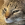
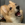
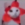
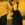
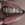
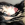
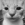
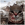
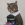

### Chat leaderboard

| Rank  | Chat                                                                                                                               | Fish Caught  | Active Players | Unique Players | Unique Fish | Channel Record 🎊                            |
|:------|:-----------------------------------------------------------------------------------------------------------------------------------|:-------------|:---------------|:---------------|:------------|:---------------------------------------------|
| 1 🥇  |  psp1g                                  | 94437 (+238) | 8 (-4)         | 3004 (+8)      | 127         | 🐳 bluewhale 303.67 lbs, disappointingtrash  |
| 2 🥈  |  breadworms                   | 92642 (+63)  | 2 (-4)         | 344 (+1)       | 132 (+1)    | 🦑 squid 308.86 lbs, lluuucy                 |
| 3 🥉  |  wuh6                                     | 46860 (+235) | 6 (-3)         | 149 (+3)       | 131         | 🦑 squid 311.04 lbs, eeziiii                 |
| 4     |  vaiastol                         | 18671 (+78)  | 2              | 78             | 123         | 🦑 squid 305.17 lbs, vaiastol                |
| 5     |  dizzy                                  | 13347        | 0              | 503            | 110         | 🦑 squid 304.76 lbs, gofishgamer             |
| 6     |  omie                                     | 12437 (+5)   | 0              | 71             | 122         | 🐻‍❄️ polarbear 294.19 lbs, mangos4u           |
| 7     |  aaurie                               | 2359 (+14)   | 0              | 179            | 78          | 🐳 bluewhale 271.57 lbs, jeffbethyname69     |
| 8     |  jellyuh                            | 1958         | 0              | 52             | 82          | 🦑 squid 307.87 lbs, pompadourdelinquent     |
| 9     |  mowogan                            | 1844 (+59)   | 2 (+1)         | 26 (+1)        | 88          | 🐉 dragon 262.91 lbs, konsminator            |
| 10    |  buhl00n                            | 1553 (+6)    | 0 (-1)         | 5              | 93          | 🐳 bluewhale 303.68 lbs, vagdy               |
| 11    |  aquaismissing          | 1082 (+2)    | 0              | 96             | 69          | 🐳 bluewhale 294.49 lbs, respirate_          |
| 12    |  ajspyman                         | 1041         | 0              | 12             | 84          | 🦕 sauropod 246.44 lbs, respirate_           |
| 13    |  ovrhtcd                            | 1036         | 0              | 42             | 59          | 🐳 bluewhale 287.76 lbs, ovrhtcd             |
| 14    |  brogboi                            | 961 (+19)    | 0              | 68 (+1)        | 59          | 🦕 sauropod 198.90 lbs, xknownplayer         |
| 15    |  swormbeard                   | 927          | 0              | 29             | 82          | 🐍 snake 264.12 lbs, pinksynthesis29         |
| 16    |  d_egree                            | 654          | 0              | 16             | 68          | 🐳 bluewhale 297.83 lbs, gofishgamer         |
| 17    |  e1llas                               | 548          | 0              | 21             | 62          | 🐳 bluewhale 254.78 lbs, respirate_          |
| 18    |  esellaaa                         | 429          | 0              | 14             | 53          | 🐳 bluewhale 277.05 lbs, zenarc              |
| 19    |  julialuxel                   | 359          | 0              | 31             | 59          | 🦕 sauropod 241.63 lbs, toastyso             |
| 20    |  evelyn_rawr                | 347          | 0              | 17             | 43          | 🐍 snake 222.67 lbs, pinksynthesis29         |
| 21    |  coolishdanker          | 273          | 0              | 21             | 35          | 🦈 shark 228.20 lbs, elisworm                |
| 22 ⬆  |  flovrek                            | 251 (+29)    | 0              | 35             | 55 (+3)     | 🦈 shark 186.35 lbs, luneckie                |
| 23 ⬇  |  pokirule                         | 234          | 0              | 4              | 49          | 🐳 bluewhale 292.52 lbs, gofishgamer         |
| 24    |  yopego                               | 207          | 0              | 23             | 50          | 🐍 snake 170.29 lbs, respirate_              |
| 25    |  ryanpotat                      | 158          | 0              | 11             | 49          | 🦕 sauropod 239.03 lbs, gofishgamer          |
| 26    |  mangos4u                         | 147          | 0              | 8              | 39          | 🐢 turtle 175.86 lbs, breadworms             |
| 27    |  lanisye                            | 105 (+2)     | 0              | 8              | 28          | 🦕 sauropod 260.67 lbs, whotookmamulukkikala |
| 28    |  xriggby                            | 94           | 0              | 7              | 35          | 🐋 whale 122.08 lbs, tipicogato              |
| 29    |  svdylan                            | 91           | 0              | 13             | 32          | 🐳 bluewhale 231.06 lbs, weapns              |
| 30    |  deme                                     | 69           | 0              | 23             | 28          | 🦭 seal 122.82 lbs, bubinga                  |
| 31    |  wiihxhx                            | 61           | 0              | 12             | 29          | 🐋 whale 77.68 lbs, respirate_               |
| 32    |  larvaew                            | 50           | 0              | 8              | 22          | 🐢 turtle 44.90 lbs, mangos4u                |
| 33    |  tipicogato                   | 38           | 0              | 6              | 25          | 🐍 snake 100.11 lbs, gofishgamer             |
| 34    |  itsbr0dyy                      | 30           | 0              | 3              | 15          | 🐊 crocodile 79.70 lbs, xyqra                |
| 35 ⬆  |  miagooper                      | 28 (+22)     | 1 (+1)         | 4 (+1)         | 12 (+6)     | 🐊 crocodile 113.47 lbs, respirate_          |
| 36 ⬇  |  n1nzin_                            | 26           | 0              | 5              | 16          | 🐊 crocodile 147.49 lbs, n1nzin_             |
| 37 ⬇  |  yanny                                  | 25           | 0              | 6              | 15          | 🐊 crocodile 101.02 lbs, softylina           |
| 38 🆕 |  eyemleonard                | 19           | 0              | 7              | 11          | 🐊 crocodile 87.79 lbs, leonard8_8           |
| 39 ⬇  |  forsengosling          | 18           | 0              | 3              | 12          | 🦕 sauropod 235.08 lbs, respirate_           |
| 40 ⬇  |  leanmeister                | 16           | 0              | 6              | 10          | 🐙 octopus 128.42 lbs, destin357             |
| 41 ⬇  |  zomballr                         | 14           | 0              | 4              | 12          | 🐋 whale 151.76 lbs, elisworm                |
| 42 ⬇  |  eavlol                               | 11           | 0              | 4              | 7           | 🐢 turtle 56.20 lbs, breadworms              |
| 43 ⬇  |  mylifeislul                | 10           | 0              | 7              | 9           | 🐙 octopus 51.36 lbs, elisworm               |
| 43 ⬇  |  oidaves                            | 10           | 0              | 3              | 10          | 🐢 turtle 67.13 lbs, 6davesdl                |
| 45 ⬇  |  paras220                         | 7            | 0              | 4              | 7           | 🦞 lobster 59.53 lbs, elisworm               |
| 45 ⬇  |  sukoxi                               | 7            | 0              | 2              | 7           | 🐋 whale 126.54 lbs, sukoxi                  |
| 47 ⬆  |  psp247                               | 4 (+3)       | 0              | 2 (+1)         | 2 (+1)      | 🍃 deadleaves 2.00 lbs, sklortch             |
| 47 ⬇  |  keeki_dechu                | 4            | 0              | 4              | 4           | 🦑 squid 110.80 lbs, crunch_sack             |
| 49 ⬇  |  de_log                               | 3            | 0              | 2              | 3           | 🐙 octopus 56.81 lbs, cd_n0                  |
| 50 ⬇  |  chellesorandom       | 2            | 0              | 1              | 2           | 🦪 oyster 37.26 lbs, rustnroll               |
| 51 ⬇  |  jackwhalebreaker | 1            | 0              | 1              | 1           | 🧃 beveragebox 4.66 lbs, flabatr0n           |
| 51 ⬇  |  sauronwins                   | 1            | 0              | 1              | 1           | 🐟 fish 10.85 lbs, gofishgamer               |
| 53 ⬇  |  avrwhy                               | 0            | 0              | 0              | 0           |   0.00 lbs,                                  |
| 53 ⬇  |  bapqo                                  | 0            | 0              | 0              | 0           |   0.00 lbs,                                  |
| 53 ⬇  |  cconnector                   | 0            | 0              | 0              | 0           |   0.00 lbs,                                  |
| 53 ⬇  |  devroyalty                   | 0            | 0              | 0              | 0           |   0.00 lbs,                                  |
| 53 ⬇  |  lifeless                         | 0            | 0              | 0              | 0           |   0.00 lbs,                                  |
| 53 ⬇  |  npqg                                     | 0            | 0              | 0              | 0           |   0.00 lbs,                                  |
| 53 ⬇  |  ommcyrene                      | 0            | 0              | 0              | 0           |   0.00 lbs,                                  |
| 53 ⬇  |  punkish_live             | 0            | 0              | 0              | 0           |   0.00 lbs,                                  |
| 53 ⬇  |  retrorelaxo                | 0            | 0              | 0              | 0           |   0.00 lbs,                                  |
| 53 ⬇  |  smoge7                               | 0            | 0              | 0              | 0           |   0.00 lbs,                                  |

_Active players means that they caught more than 10 fish in the last seven days_

_Unique players is how many different players caught a fish in that chat_

_Last updated at 2026-11-22 10:54:41 UTC_